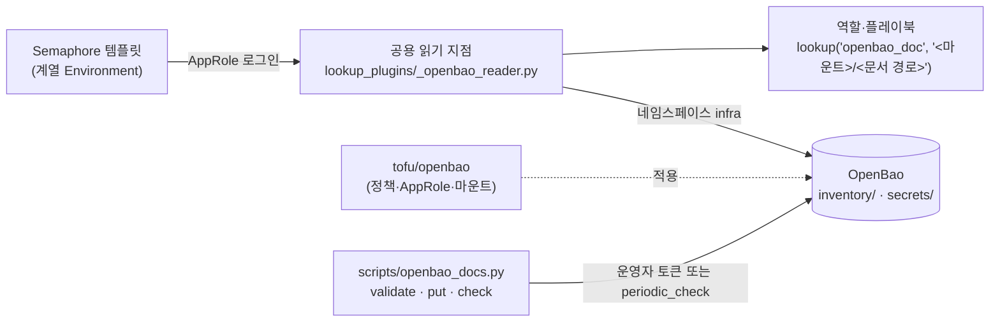

# OpenBao 구조와 읽기 지점

이 저장소의 자동화가 OpenBao에서 값을 읽는 방식을 설명한다: 어디에 무엇을 저장하는지, 코드가 어떻게 읽는지, 누가 무엇을 읽을 수 있는지, 없으면 어떻게 실패하는지. 결정과 기각한 대안은 [ADR-0014](adr/0014-openbao-storage-structure-and-access-policy.md), 용어는 [CONTEXT.md](../CONTEXT.md)(Asset·Endpoint·Credential·Automation Identity·Service·Operator)를 따른다.

문서 키의 정의는 이 문서에 복사하지 않는다. 원본은 `schemas/openbao/`의 스키마(키 설명은 각 스키마의 `description`)와 경로 패턴 대응표 `schemas/openbao/index.yml`이다. 누가 어느 경로를 읽는지의 원본은 `tofu/openbao/policies/*.hcl`과 `tofu/openbao/approles.tf`다.

## 1. 개요



- 값은 OpenBao에만 있고 Git에는 없다. 코드는 문서 경로와 키 이름만 안다.
- 문서를 읽는 곳은 공용 읽기 지점 하나다. 역할마다 접두사·마운트·인증 설정을 따로 갖지 않는다.
- 문서를 쓰는 곳은 등록 도구(`scripts/openbao_docs.py put`)뿐이고, 스키마 검증을 통과해야 쓴다([openbao_docs.md](openbao_docs.md)).

## 2. 골격

네임스페이스는 `infra` 하나이고 그 안에 KV v2 마운트 둘을 둔다. 비밀이 아닌 값은 `inventory/`, 비밀만 `secrets/`다. 네임스페이스와 마운트를 바꾸는 변수나 환경 변수는 없다.

| 소유 대상 | 비밀이 아닌 값 | 비밀 | 스키마 |
|---|---|---|---|
| Asset | `inventory/assets/<관리번호>` | `secrets/assets/<관리번호>/agents`(호스트별 에이전트 비밀) | `asset.schema.json`, `agents.schema.json` |
| Asset의 접속 | `inventory/assets/<관리번호>/endpoints` | `secrets/assets/<관리번호>/credentials/<이름>` | `endpoints.schema.json`, `credential.schema.json` |
| Service(OpenObserve·RustFS·GitHub·Semaphore·FUNA) | `inventory/services/<서비스>` | `secrets/services/<서비스>/<권한 이름>` | `service_*.schema.json`, `secrets/services/` |
| Operator | `inventory/operators/<계정>`(공개키) | 없음 | `operator.schema.json` |
| Automation Identity | 없음 | `secrets/automation/ssh` | `automation_ssh.schema.json` |
| 작업 설정 | `inventory/config/<작업>` | 없음 | `inventory/config/*.schema.json` |

경로 패턴과 스키마의 정확한 대응은 `schemas/openbao/index.yml`만이 원본이다. 알림 웹훅 URL(`secrets/services/alert/notify`)처럼 URL 자체가 권한인 값은 Service 비밀이다.

## 3. 저장 규칙

1. **소유 대상별로 둔다.** 한 문서에는 한 소유 대상의 값만 있다. 같은 Asset의 값이라도 비밀이 아니면 `inventory/`, 비밀이면 `secrets/`다.
2. **계산값은 저장하지 않는다.** 주소를 이름으로 줄인 값, 파일명, 다른 문서에서 유도되는 값은 코드가 계산한다.
3. **그룹 공통값은 OpenBao가 아니다.** 여러 호스트가 같이 쓰는 설정은 Semaphore 인벤토리의 그룹 변수나 역할 `defaults/`에 둔다. 저장소의 `inventory/group_vars`는 Semaphore 인벤토리에 적용되지 않으므로 쓰지 않는다.
4. **비밀을 Git·실행 변수에 두지 않는다.** 역할이 문서의 값을 실행 변수(Extra variables)로 덮어쓰게 두지 않는다. 바꾸려면 문서를 고친다.
5. **키 이름은 도메인 용어의 snake_case다.** 도구 이름(`ansible_host`)이나 별칭을 쓰지 않는다. 스키마는 `additionalProperties: false`라 모르는 키는 등록되지 않는다.
6. **쓰기는 등록 도구로만 한다.** 스키마 검증과 `cas`(동시 수정 방지)가 거기에 있다. 정책으로 강제할 수 없는 운영 규칙이다.

## 4. 접속 해석

SSH·API 접속 정보는 Asset 문서의 Endpoint와 Credential이 정한다. 서버·스위치·방화벽 모두 같은 방식이다.

**공용 읽기 지점**: `lookup('openbao_doc', '<마운트>/<문서 경로>')`는 문서의 데이터 맵을 돌려준다. `lookup('openbao_doc', '@token')`은 로그인으로 얻은 토큰만 돌려준다(플레이당 한 번 로그인해 `_vault_token` 변수로 넘길 때 쓴다).

```yaml
- ansible.builtin.set_fact:
    _doc: "{{ lookup('openbao_doc', 'inventory/assets/' ~ inventory_hostname) }}"           # 없으면 실패
    _opt: "{{ lookup('openbao_doc', 'inventory/config/host_audit', required=false) }}"      # 없으면 {} (명시한 호출만)
  no_log: true   # secrets/ 문서를 읽는 태스크는 반드시 no_log
```

**접속 해석** `lookup('openbao_connection', <관리번호>, preference=[...], credential=<이름>)`

| 입력 | 뜻 |
|---|---|
| `preference` | Endpoint 이름의 선호 순서 목록(작업 기본값. 서버 `[ssh]`, FortiGate `[https]`, Cisco `[ssh, telnet]`). 등록된 것 중 첫 번째만 쓴다. 접속에 실패해도 다른 Endpoint로 넘어가지 않는다 |
| `credential` | 선택. Endpoint 기본 Credential 대신 쓸 이름(`access` 절의 admin·bootstrap). 기본과 다르면 그 Credential 자신의 비밀로 로그인한다 |

결과(비밀을 담으므로 `no_log`): `endpoint`·`protocol`·`address`·`port`, `credential`(로그인에 쓴 이름), `login`(`mode`: `identity`·`password`·`key`·`token`과 `username` 및 해당 비밀), `become`(`method`: `sudo`·`su`·`enable`, `password`; 승격이 없으면 `{}`), `password_auth_exception`(identity 없는 ssh Endpoint를 Credential 자신의 비밀번호로 로그인하면 true), `via`(경유 체인, 컨트롤러에서 가까운 경유지부터).

- **Automation Identity**: Endpoint에 `identity: automation`이면 Automation Identity 키(`secrets/automation/ssh`)로 Credential의 `username`에 로그인하고 Credential `password`는 승격에만 쓴다. 없으면 Credential 자신의 비밀로 로그인한다(identity 없는 ssh Endpoint를 Credential 자신의 비밀번호로 로그인하면 예외로 취급해 `password_auth_exception`이 true다. identity가 없어도 ssh_key Credential로 로그인하면 키 접속이라 false다).
- **승격**: 비밀번호는 `become.credential`의 비밀번호이고, 생략하면 로그인 Credential의 `password`다. `su`는 비밀번호가 없으면 실패한다.
- **경유**: `via`는 `<관리번호>/<endpoint>`를 끝까지 따라가며 경유지마다 자기 Endpoint의 기본 Credential·`identity`를 쓴다. 순환·없는 참조는 실패한다. 키 로그인 경유지만 `ProxyCommand`로 만들 수 있고(`openbao_ssh_common_args`·`openbao_ssh_proxy_command` 필터) 비밀번호 경유지는 거부한다. 비밀을 뺀 요약은 `openbao_connection_summary` 필터다.
- **관리 계정**: 호스트 묶음 lookup(아래)의 `admin_accounts`가 Asset의 `access.admin_credentials`를 common 역할의 `accounts`로 만든다. 계정 이름은 Credential의 `username`이고, 공개키는 자동화 계정이면 `secrets/automation/ssh`의 `public_key`, 그 밖에는 `inventory/operators/<계정>`의 `public_keys`·`revoked_keys`다(서버 계열 `connect` 정책이 이 문서를 읽는다).

- **호스트 묶음**: `lookup('openbao_host_connection', <관리번호>, preference=[...])`는 Asset 문서, 관리·부트스트랩 연결, 관리 계정 목록(`asset`·`admin`·`bootstrap`·`admin_accounts`와 `access`의 Credential 이름)을 읽기 객체 하나로 한 번에 만든다. `requires_access=true`(프로비저닝 대상)면 `access` 절이 없을 때 연결을 해석하기 전에 `[ACCESS-MISSING]`으로 실패한다. `resolve_connection.yml`이 호스트당 이것 한 번만 부르므로 같은 문서(Endpoint·Credential·Automation Identity 키)를 호스트당 한 번씩만 읽는다. 개별 lookup `openbao_connection`은 네트워크 장비 백업이 쓴다.

**`playbooks/common/resolve_connection.yml`** (서버 플레이북이 첫 플레이로 import)

임시 SSH 개인키 파일(관리·부트스트랩·경유지)은 `playbooks/common/stage_ssh_key.yml` 한 곳에서 만든다. 키에 암호문이 있으면 `ssh-keygen -P`(인자라 `ps`에 보인다)가 아니라 `SSH_ASKPASS`(키 파일 옆에 잠깐 만드는 비밀 없는 스크립트)와 환경 변수 `BAO_KEY_PASSPHRASE`로 넘긴다. 임시 디렉터리가 `noexec`로 마운트된 러너에서는 askpass 스크립트를 실행하지 못해 암호문 제거가 실패한다(그때는 임시 디렉터리를 바꾼다). 키를 쓰거나 암호문을 벗기는 단계가 실패하면 헬퍼가 그 자리에서 키 파일을 지우고 실패한다. 이 헬퍼 밖(뒤 플레이)에서 호스트가 실패하면 ansible-playbook이 그 호스트를 뒤 플레이에서 빼 `cleanup_connection`이 돌지 못하므로 키가 임시 디렉터리에 남을 수 있다. 이를 `ansible-playbook` 안에서 보장하는 방법은 없어(플레이북 전체의 `always`가 없다), 다음 `resolve_connection` 실행이 12시간 넘은 `*_bao_{admin,boot,hop}_key` 파일을 지운다. 그 사이에도 파일은 `0600`이다.

| 입력 변수 | 뜻 |
|---|---|
| `connection_endpoint_preference` | 선호 순서 목록. 기본 `[ssh]` |
| `connection_requires_access` | true면 Asset 문서에 `access` 절(`admin_credentials`·`bootstrap_credential`)이 없을 때 실패한다. `site.yml`(프로비저닝)이 켠다 |
| `connection_needs_accounts` | false면 관리 계정 공개키(`inventory/operators/<계정>`)를 읽지 않는다. 기본 true(프로비저닝·Host Audit). `accounts`를 쓰지 않는 Host Agents가 끈다 |
| `target_removed_users` | 이번 실행에서 지울 계정. `access.removed_accounts`와 합집합이다. 계정 입력 중 실행 변수로 남은 유일한 값이다 |

출력 팩트는 접속 변수(`ansible_host`·`ansible_port`·`ansible_user`·`ansible_password`·`ansible_ssh_private_key_file`·`ansible_ssh_common_args`·`ansible_become_method`·`ansible_become_password`·`ansible_python_interpreter`), `ip`(인벤토리 `ip`가 있으면 그 값, 없으면 선택된 Endpoint 주소), `accounts`, `_removed_users`, `_normalized_admin_users`, `_is_already_provisioned`, `_asset_doc`(Asset 문서), `_connection`(비밀 없는 요약), `_vault_token`이다. 관리 계정 키로 접속이 안 되면 `access.bootstrap_credential`의 연결로 바꾸고, 임시 키 파일은 `cleanup_connection.yml`이 지운다. 원격 Python 인터프리터는 항상 `/usr/bin/python3`다.

## 5. 인증과 정책

### 5.1 읽기 지점의 인증

- **AppRole만 쓴다.** 변수 `_vault_token`(플레이 첫머리에서 `@token`으로 받아 둔 토큰)이 있으면 그것을, 없으면 `VAULT_ROLE_ID`/`VAULT_SECRET_ID`(같은 이름 소문자 변수도 된다)로 로그인한다. 평문 토큰(`VAULT_TOKEN`)으로는 읽지 않는다. 주소는 `VAULT_ADDR`(`vault_addr`)다.
- **https 인증서는 기본으로 검증한다.** 사설 CA는 `VAULT_CACERT`(`vault_cacert`)로 준다. 검증을 끄려면 `vault_validate_certs: false` 또는 `VAULT_SKIP_VERIFY=true`이고 마지막 수단이다.
- **토큰 TTL은 30분이다.** 로그인은 프로세스 안에서만 캐시한다. Ansible은 호스트·태스크마다 프로세스를 나누므로 `@token`을 받아 두지 않는 읽기는 그 호스트·태스크마다 로그인한다. 긴 플레이(Host Audit의 드리프트 하위 실행 등)가 만료된 토큰을 들고 있지 않도록 오래 쓸 토큰은 일찍 받아 두지 않는다.
- **만료된 토큰은 한 번 다시 로그인한다.** `_vault_token`으로 읽다가 403이면 AppRole로 새로 로그인해 같은 읽기를 되풀이한다(30분 넘게 걸리는 실행의 후반 호스트가 멈추지 않게 한다). 새 토큰은 그 읽기 호출 안에서만 쓰이므로, 만료 뒤에는 태스크마다 로그인이 한 번씩 더 나간다. 정책이 막은 403은 다시 로그인해도 같은 403이라 그대로 실패한다. `VAULT_ROLE_ID`/`VAULT_SECRET_ID`가 없으면 되풀이하지 못하고 실패한다.
- **실패 사유는 `no_log`와 무관하게 보인다.** 읽기 지점과 접속 해석 lookup은 실패 메시지(문서 경로와 HTTP 상태·예외 종류·키 이름만, 응답 본문과 비밀은 없음)를 Ansible 표시 채널로도 낸다. 비밀을 돌려주는 태스크가 `no_log: true`여도 운영자가 403(정책)과 연결 오류(주소·TLS)를 구분할 수 있다. 고정 ansible-core 2.21.4에서는 인자 해석 중 lookup 오류가 `no_log`여도 이미 보이므로(같은 메시지가 한 번 더 나온다) 이 표시는 버전·문맥에 따라 `no_log`가 사유를 가릴 때를 위한 안전장치다. 호출자가 `errors='ignore'`·`'warn'`으로 실패를 직접 다루는 읽기는 `quiet=true`를 함께 줘 이 표시를 ERROR에서 상세(`-vv`) 수준으로 낮춘다(기본 strict는 항상 ERROR로 낸다).
- **같은 읽기 호출 안에서는 문서를 한 번만 읽는다.** 한 lookup 호출(`Reader`)이 읽은 문서는 다시 HTTP로 읽지 않는다.
- **우회(`openbao_fixture`)**: 변수 `openbao_fixture`가 정의돼 있으면 네트워크 없이 그 안에서만 답한다. 키는 `<마운트>/<문서 경로>`, 값은 문서다. 없는 키는 404와 같다. molecule·테스트용이며 운영 템플릿의 Extra variables에 넣지 않는다.
- 운영자가 로컬에서 쓰는 `scripts/`의 도구(`openbao_docs.py`, 수집 스크립트)는 읽기 지점이 아니라 자기 접속 코드를 쓰며 운영자 토큰(`VAULT_TOKEN`)을 받을 수 있다. 이 예외는 Ansible 쪽으로 새지 않는다.

### 5.2 계열, 템플릿, Environment

Semaphore 템플릿은 작업 계열마다 AppRole 하나와 Environment 하나를 쓴다. 계열이 읽는 경로는 정책 HCL이 정한다.

| 계열(AppRole·Environment) | 템플릿 |
|---|---|
| `provision` | Host Provisioning |
| `host_agents` | Host Agents — Deploy·Config·Deploy Restic |
| `backup_maintenance` | Host Agents — Repo Maintenance |
| `openobserve_config` | OpenObserve — Config |
| `host_audit` | Host Audit — Monthly·On-demand·Resend |
| `network_backup` | Cisco·FortiGate 백업 |
| `github_webhook_watch` | 조직 웹훅 감시 |
| `periodic_check` | OpenBao — Periodic Check |
| `agent_session` | 에이전트 세션(Semaphore 밖) |
| `applier` | OpenBao — OpenTofu(적용 전용) |

Environment 변수와 등록은 [semaphore-setup.md](semaphore-setup.md) 4절, secret_id 발급·교체는 [openbao-operations](runbooks/openbao-operations.md)다. 계열 × 경로 매트릭스는 복사하지 않는다: `tofu/openbao/policies/*.hcl`(경로 묶음 단위의 작은 정책)과 `tofu/openbao/approles.tf`(계열이 조합하는 정책)가 원본이고, `tests/test_openbao_policies.py`가 매트릭스를, `tests/test_openbao_role_policy_contract.py`가 각 역할이 읽는 문서가 그 계열 정책 안에 있는지를 묶어 둔다. `host_audit`은 드리프트 하위 실행이 `site.yml`과 Host Agents Config를 같은 AppRole로 렌더링하므로 `provision`과 `host_agents`의 경로를 모두 읽는다.

### 5.3 사람과 에이전트

- `operator`: `infra` 안 userpass 사용자. 전체 읽기(list 포함)와 create/update만 하고 delete·`sys/`는 없다. 등록 도구가 이 권한으로 쓴다.
- `admin`: 루트 네임스페이스의 비상용. 삭제·영구 삭제·정책 수동 변경에만 쓴다([openbao-operations](runbooks/openbao-operations.md)).
- 에이전트 세션(`agent_session`): `inventory/` 전체와 `secrets/`의 메타데이터(키 이름·버전)만 읽고 비밀 값은 읽지 못한다. 비밀 값이 필요하면 계열 템플릿을 실행하거나 운영자에게 요청한다(AGENTS.md 4절).

정책·AppRole·마운트는 OpenTofu 코드로만 바꾼다([openbao_opentofu.md](openbao_opentofu.md)).

## 6. 실패 규칙

대체값이 없다.

- 문서가 없으면(404) 실패한다. `required=false`를 명시한 호출만 `{}`를 받는다(작업 설정처럼 선택인 문서).
- 403(정책 밖)·연결 오류·인증 정보 없음은 항상 실패한다. 기본값으로 대신하지 않는다.
- 알 수 없는 마운트(`inventory`·`secrets` 밖)는 요청을 보내기 전에 실패한다.
- 오류 메시지에는 문서 경로와 상태 코드만 있다. 응답 본문은 비밀을 담을 수 있어 넣지 않는다.
- 역할의 `vars/main.yml`에 `<역할>_openbao_required`로 `{index.yml 패턴: [필수 키, ...]}`를 선언한다(필수 키가 없는 선택 문서는 `[]`). 입력 검증이 문서 경로와 키 이름만 대며 실패하고, 같은 선언을 스키마 `required` 대조 테스트와 요청 기록 단언이 쓴다.

```yaml
monitoring_openbao_required:
  "secrets/assets/+/agents": [restic_password]
  "inventory/assets/+": []
```

## 7. 새 플레이북 작성 템플릿

접속이 필요한 플레이북은 `playbooks/common/`의 해석·정리 플레이를 import하고, 읽는 문서는 `<역할>_openbao_required`로 선언한다. 참고 예제는 [playbooks/example_task.yml](../playbooks/example_task.yml)이다.

```yaml
---
- name: Resolve OpenBao Connection and Credentials
  ansible.builtin.import_playbook: common/resolve_connection.yml

- name: Execute Custom Host Tasks
  hosts: "{{ target_hosts | default('servers:loadbalancers') }}"
  become: true
  gather_facts: true
  tasks:
    - name: Run custom commands or maintenance tasks
      ansible.builtin.command: uname -a
      register: _result
      changed_when: false

- name: Cleanup Controller Temporary Credentials
  ansible.builtin.import_playbook: common/cleanup_connection.yml
```

특정 호스트만 돌리려면 Extra variable `target_hosts`를 준다: `ansible-playbook -i inventory/hosts.yml playbooks/example_task.yml -e "target_hosts=ns0331"`.

새 역할이 OpenBao 문서를 읽으면 (1) `vars/main.yml`에 `<역할>_openbao_required`를 선언하고 (2) 그 역할을 돌리는 계열 AppRole 정책이 패턴을 읽게 하며 (3) `tests/test_openbao_role_policy_contract.py`의 역할↔계열 표에 한 줄을 더한다. 정책 누락은 이 테스트가 잡는다. 공용 읽기 지점의 lookup이 대신 읽는 문서(호스트 묶음의 관리 계정 공개키 `inventory/operators/<계정>` 등)는 역할 선언에 나오지 않으므로 `lookup_plugins/openbao_connection.py`의 `*_READS` 표에 적고, 같은 테스트가 그 표와 코드의 `read()` 호출, 계열 정책(`connect`)을 대조한다. lookup을 쓰는 새 파일은 테스트의 `LOOKUP_USERS` 표에 한 줄을 더해야 통과한다.

## 8. 관련 문서

- 결정: [ADR-0014](adr/0014-openbao-storage-structure-and-access-policy.md)
- 스키마와 대응표: `schemas/openbao/`, `schemas/openbao/index.yml`
- 등록·점검 도구: [openbao_docs.md](openbao_docs.md)
- 정책·AppRole 코드: [openbao_opentofu.md](openbao_opentofu.md), `tofu/openbao/`
- 운영: [openbao-operations](runbooks/openbao-operations.md), 전환(일회성): [openbao-cutover](runbooks/openbao-cutover.md)
- Semaphore Environment: [semaphore-setup.md](semaphore-setup.md)
- 역할별 읽는 문서: [funa_env.md](funa_env.md), [host_audit.md](host_audit.md), [backup.md](backup.md), [openobserve_config.md](openobserve_config.md), [cisco_backup.md](cisco_backup.md), [fortigate_backup.md](fortigate_backup.md), [github_webhook_watch.md](github_webhook_watch.md)
