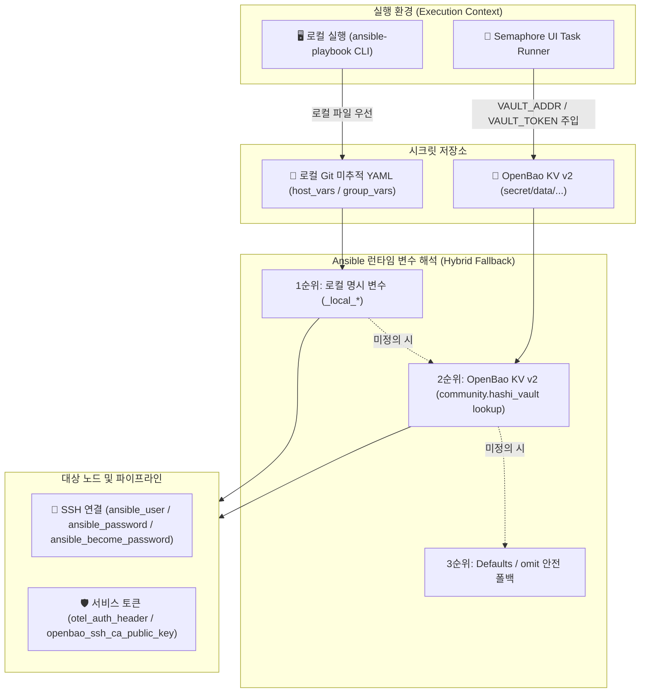

# OpenBao & Semaphore UI Secret Management Integration Guide

본 문서는 **Semaphore UI** 최신 버전과 **OpenBao**(HashiCorp Vault 호환 Secret Manager)를 연동하여 대상 노드 프로비저닝 시크릿을 안전하게 주입하고 관리하는 표준 아키텍처 및 설정 가이드입니다.

---

## 1. 아키텍처 개요 (Architecture Overview)



---

## 2. OpenBao KV v2 Secret Path 표준 명세

OpenBao의 `secret/` (KV v2) 마운트 아래에 다음과 같이 경로와 키를 배치합니다:

### (0) 공용 읽기 지점과 접속 해석 (Spec #511 / Ticket-12)

> 이 절이 새 구조의 공개 인터페이스다. 옛 `hosts/<ns>`·`users/<계정>` 경로, 접두사 변수, 주소 별칭 대체 체인, 부트스트랩 자동 대체값은 없다.
> 문서 키의 정의는 `schemas/openbao/`(원본)에 있고 여기에 복사하지 않는다. 구조 문서 전체 재작성은 전환 PR이 한다(#509).

**읽기 지점 하나.** 네임스페이스(`infra`), 마운트(`inventory`·`secrets`), 인증, 우회는 `lookup_plugins/openbao_doc.py`에서만 정한다.
역할·플레이북은 경로 접두사를 갖지 않고 `<마운트>/<문서 경로>`만 쓴다.

```yaml
- ansible.builtin.set_fact:
    _doc: "{{ lookup('openbao_doc', 'inventory/assets/' ~ inventory_hostname) }}"           # 없으면 실패
    _opt: "{{ lookup('openbao_doc', 'inventory/config/host_audit', required=false) }}"      # 없으면 {} (명시한 호출만)
  no_log: true   # secrets/ 문서를 읽는 태스크는 반드시 no_log
```

- 문서가 없거나(404) 403이거나 연결이 안 되면 실패한다. 기본값으로 대체하지 않는다. 실패 메시지에는 문서 경로와 상태 코드만 있다.
- 인증 순서: 변수 `_vault_token`(resolve_connection이 플레이당 한 번 받아 둔 토큰) -> AppRole(`VAULT_ROLE_ID`/`VAULT_SECRET_ID` 또는 같은 이름 소문자 변수) -> `VAULT_TOKEN`. 주소는 `VAULT_ADDR`(`vault_addr`).
  네임스페이스·마운트·접두사를 바꾸는 변수나 환경 변수는 없다(`VAULT_NAMESPACE`·`VAULT_MOUNT`는 읽지 않는다).
- `lookup('openbao_doc', '@token')`은 토큰만 돌려준다. 플레이당 한 번 로그인할 때 쓴다.
- 우회(`openbao_fixture`): 변수 `openbao_fixture`가 정의돼 있으면 네트워크 없이 그 안에서만 답한다. 키는 `<마운트>/<문서 경로>`(예: `inventory/assets/ns0001`), 값은 문서다.
  없는 키는 404와 같다. 이 변수는 읽기 지점에서만 처리한다(molecule용. 기본 데이터는 `tests/fixtures/openbao_docs/valid`).

**접속 해석** `lookup('openbao_connection', <관리번호>, preference=[...], credential=<이름>)`

| 입력 | 뜻 |
|---|---|
| `preference` | Endpoint 이름의 선호 순서 목록(작업 기본값. 서버 `[ssh]`, FortiGate `[https]`, Cisco `[ssh, telnet]`). 등록된 것 중 첫 번째만 쓴다. 접속에 실패해도 다른 Endpoint로 넘어가지 않는다 |
| `credential` | 선택. Endpoint 기본 Credential 대신 쓸 이름(`access` 절의 admin·bootstrap). 기본과 다르면 그 Credential 자신의 비밀로 로그인한다 |

결과(비밀을 담으므로 `no_log`): `endpoint`·`protocol`·`address`·`port`, `credential`(로그인에 쓴 이름), `login`(`mode`: `identity`·`password`·`key`·`token`과 `username` 및 해당 비밀),
`become`(`method`: `sudo`·`su`·`enable`, `password`; 승격이 없으면 `{}`), `password_auth_exception`(ssh Endpoint에 `identity`가 없으면 true), `via`(경유 체인, 컨트롤러에서 가까운 경유지부터).

- `identity: automation`이면 Automation Identity 키(`secrets/automation/ssh`)로 `username`에 로그인하고 Credential `password`는 승격에만 쓴다. 없으면 Credential 자신의 비밀로 로그인한다.
- `become`: 비밀번호는 `become.credential`의 비밀번호이고, 생략하면 로그인 Credential의 `password`다. `su`는 비밀번호가 없으면 실패한다.
- `via`: `<ns>/<endpoint>`를 끝까지 따라가며 경유지마다 자기 Endpoint의 기본 Credential·`identity`를 쓴다. 순환·없는 참조는 실패한다.
  `openbao_connection_summary` 필터는 비밀을 뺀 요약을, `openbao_ssh_common_args`·`openbao_ssh_proxy_command` 필터는 hop 키 임시 파일 경로 목록으로 `ProxyCommand`를 만든다(키 로그인 경유지만 지원, 비밀번호 경유지는 거부).
- 관리 계정: `lookup('openbao_admin_accounts', <관리번호>, preference=[...])`가 `access.admin_credentials`를 common 역할의 `accounts`로 만든다.
  계정 이름은 Credential의 `username`이고, 공개키는 자동화 계정이면 `secrets/automation/ssh`의 `public_key`, 그 밖에는 `inventory/operators/<username>`의 `public_keys`·`revoked_keys`다.

**`playbooks/common/resolve_connection.yml` 입력과 출력**

| 입력 변수 | 뜻 |
|---|---|
| `connection_endpoint_preference` | 선호 순서 목록. 기본 `[ssh]` |
| `connection_requires_access` | true면 Asset 문서에 `access` 절(`admin_credentials`·`bootstrap_credential`)이 없을 때 실패한다. `site.yml`(프로비저닝)이 켠다 |
| `target_removed_users` | 이번 실행에서 지울 계정. `access.removed_accounts`와 합집합이다. 계정 입력 중 실행 변수로 남은 유일한 값이다 |

출력 팩트: `ansible_host`·`ansible_port`·`ansible_user`·`ansible_password`·`ansible_ssh_private_key_file`·`ansible_ssh_common_args`(경유 시)·`ansible_become_method`·`ansible_become_password`(승격이 있을 때)·`ansible_python_interpreter`(`/usr/bin/python3`),
`ip`(인벤토리 `ip`가 있으면 그 값, 없으면 선택된 Endpoint 주소), `accounts`, `_removed_users`, `_normalized_admin_users`, `_primary_admin_user`, `_is_already_provisioned`(관리 계정 키 접속 시험 성공),
`_asset_doc`(Asset 문서), `_connection`(비밀 없는 요약: `endpoint`·`address`·`port`·`credential`·`login_mode`·`become_method`·`password_auth_exception`·`via`), `_vault_token`.
관리 계정 접속이 안 되면 `access.bootstrap_credential`의 연결로 바꾼다. 임시 키 파일은 `cleanup_connection.yml`이 지운다.

**`<역할>_openbao_required` 선언 형식.** 역할의 `vars/main.yml`에 `{index.yml 패턴: [필수 키, ...]}`로 둔다. 필수 키가 없는 선택 문서는 `[]`다.
입력 검증 assert, 스키마 `required` 대조 테스트, 요청 기록 단언(읽은 문서가 선언한 패턴 안에 있는가)이 같은 선언을 쓴다.

```yaml
monitoring_openbao_required:
  "secrets/assets/+/agents": [restic_password]
  "inventory/assets/+": []
```

### (1-1) FUNA Cluster 환경 값 (`funa_env`, #222)
`funa_cluster` 그룹 호스트에만 쓰인다. **값은 이 문서와 Git에 두지 않는다.** KV 키 이름이 곧 환경 변수 이름이다. 자세한 필수 키는 [docs/funa_env.md](funa_env.md).
* `secret/data/hosts/<inventory_hostname>`: 노드별 키 `FUNA_NODE_EXTERNAL_HOSTNAME`, `FUNA_NODE_EXTERNAL_WILDCARD_HOSTNAME`(→ `cluster.env`)과 노드마다 값이 다른 시크릿 `CLOUDFLARE_API_TOKEN`(→ `proxy.secrets.env`)을 기존 호스트 KV에 **추가**한다(역할은 이 키들만 읽는다).
* `secret/data/clusters/funa`: 클러스터 공통 비시크릿(→ `cluster.env`, `0644`). 키 전부를 렌더링한다.
* `secret/data/clusters/funa/proxy`: Caddy 시크릿(→ `proxy.secrets.env`, `0640 root:dockermgmt`).
* `secret/data/clusters/funa/vrrp`: keepalived 시크릿(→ `vrrp.secrets.env`, `0640 root:dockermgmt`).
* 정책: Semaphore AppRole에 위 경로의 **읽기** 권한이 필요하다(`clusters/funa/*`). 경로가 없거나 필수 키가 빠지면 플레이는 경로·키 이름을 대며 실패한다.

### (4) 네트워크 장비(Cisco·FortiGate) 접속 정보 (Spec #511 / Ticket-18)
Asset 하나에 Endpoint와 Credential로 둔다(옛 `hosts/<ns>`의 `ansible_*`·`connection_type`·`bastion_host`와 별도 경로 `fortigate/<ns>`는 없다).
* Cisco: Endpoint `ssh`·`telnet`(선호 순서 `[ssh, telnet]`), 로그인 Credential(`password`), 승격 `become: enable`. 비밀번호 로그인 경유지는 `via`로 한 단까지 역할이 직접 처리한다. 자세한 규칙은 [cisco_backup.md](cisco_backup.md).
* FortiGate: Endpoint `https`와 Credential `api`(`api_token`), 알림은 `secrets/services/alert/notify`(text/plain `url`). 자세한 규칙은 [fortigate_backup.md](fortigate_backup.md).

### (5) 전역 인프라 서비스 시크릿
* **경로**: `secret/data/global/services`
* **필드 (Key-Value)**:

  ```json
  {
    "openbao_ssh_ca_public_key": "ssh-ed25519 AAAAC3NzaC1lZDI1NTE5AAAAI... openbao-ca@internal",
    "otel_auth_header": "Bearer gls_secret_otlp_token_here",
    "boundary_token": "s.boundary_worker_auth_token"
  }
  ```

---

## 3. Semaphore UI 최신 버전 연동 가이드

Semaphore UI 최신 버전은 **OpenBao** 및 **HashiCorp Vault**를 일급 시민(First-Class) 스토리지 백엔드로 지원합니다.

### 1단계: Semaphore Settings에서 OpenBao Storage 설정
1. Semaphore UI 대시보드 진입 ➔ **Settings** ➔ **Secrets / Key Store**
2. **Storage Type**을 `OpenBao` 또는 `HashiCorp Vault`로 지정
3. OpenBao Server URL (`https://openbao.internal:8200`), Mount Path (`secret`), Token 또는 Vault Agent 토큰 파일 경로(`/var/run/openbao/token`) 설정

### 2단계: Key Store 등록
* **Type**: `OpenBao`
* **Path**: `secret/data/semaphore/ssh_key` 또는 `secret/data/semaphore/sudo_pass`
* Semaphore가 태스크 실행 시 OpenBao로부터 인증서를 실시간으로 취득하여 Runner에 주입합니다.

### 3단계: Environment (Variable Group) 구성
Semaphore UI의 **Environment / Variable Groups**에 Ansible 및 `community.hashi_vault` lookup을 위한 환경변수와 Extra Variables를 등록합니다:

* **Environment variables (환경 변수)**:
  ```json
  {
    "VAULT_ADDR": "https://openbao.internal:8200",
    "VAULT_NAMESPACE": "root",
    "VAULT_SKIP_VERIFY": "false"
  }
  ```
* **Extra variables (추가 변수)**:
  ```json
  {
    "cisco_backup_dir": "/opt/backups/cisco"
  }
  ```
* **Secrets (보안 변수 - AppRole 인증 시)**:
  - `VAULT_ROLE_ID`: OpenBao AppRole Role ID
  - `VAULT_SECRET_ID`: OpenBao AppRole Secret ID

---

## 5. 신규 플레이북 작성을 위한 재사용 연결 모듈 (`common/resolve_connection.yml`)

모든 신규 플레이북에서 OpenBao 자격증명 조회, SSH 키 복호화, 접속 진단(Probe), 부트스트랩 전환 로직을 중복 구현할 필요 없이 `playbooks/common/` 모듈을 `ansible.builtin.import_playbook`으로 재사용할 수 있습니다.

### (1) 제공되는 공통 모듈
1. `playbooks/common/resolve_connection.yml` (입력·출력은 위 (0)절):
   - 공용 읽기 지점으로 OpenBao 토큰을 플레이당 한 번 받는다
   - Asset 문서의 Endpoint·Credential로 주소·포트·계정·승격·경유(`via`)를 해석한다
   - 관리 계정 개인키 복호화(Passphrase 해제)와 임시 파일화, 접속 시험(Probe), 실패 시 `access.bootstrap_credential` 연결로 전환
   - 원격 Python 인터프리터는 항상 `/usr/bin/python3`
2. `playbooks/common/cleanup_connection.yml`:
   - 컨트롤러에 임시 생성된 SSH 키 파일 안전 제거

### (2) 신규 플레이북 작성 표준 템플릿 (참고 예제: `playbooks/example_task.yml`)

저장소 내 [playbooks/example_task.yml](file:///home/ppzxc/projects/infra-automation/playbooks/example_task.yml) 파일이 바로 복사/참고하여 사용할 수 있는 공식 템플릿입니다.

```yaml
---
# 1. OpenBao 자격증명 및 서버 접속 연결 사전 해결
- name: Resolve OpenBao Connection and Credentials
  ansible.builtin.import_playbook: common/resolve_connection.yml

# 2. 본 작업 플레이 (임의의 작업 수행)
- name: Execute Custom Host Tasks
  hosts: "{{ target_hosts | default('servers:loadbalancers') }}"
  become: true
  gather_facts: true
  tasks:
    - name: Run custom commands or maintenance tasks
      ansible.builtin.command: uname -a
      register: _result
      changed_when: false

    - name: Print host status
      ansible.builtin.debug:
        msg: "Connected successfully to {{ inventory_hostname }}: {{ _result.stdout }}"

# 3. 컨트롤러 임시 키 정리
- name: Cleanup Controller Temporary Credentials
  ansible.builtin.import_playbook: common/cleanup_connection.yml
```

### (3) 특정 호스트만 지정하여 실행 (Semaphore Task Template)
Semaphore UI 또는 CLI 실행 시 Extra Variable로 `target_hosts`를 지정하여 특정 단일 호스트 또는 그룹만 필터링하여 실행할 수 있습니다:
```bash
ansible-playbook -i inventory/hosts.yml playbooks/example_task.yml -e "target_hosts=ns0331"
```

